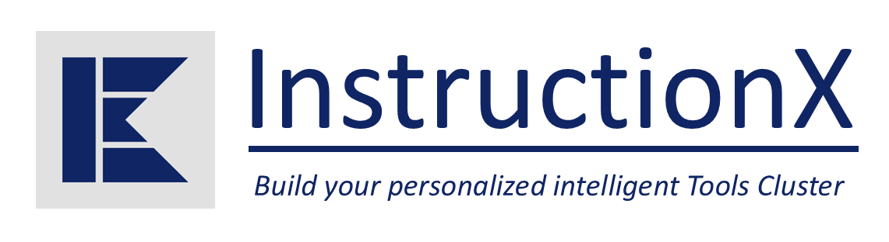

<div align="center">



**一个用 PySide6 写的桌面插件框架**

[](https://github.com/KKPIP-Tech/InstructionX/actions/workflows/test.yml)
[](https://www.python.org/)
[](https://doc.qt.io/qtforpython/)
[](#)
[](#)
[](LICENSE)

中文版 | [English Version](README_EN.md) | [Version française](README_FR.md) | [Русская версия](README_RU.md)

</div>

## InstructionX 是什么

InstructionX 负责桌面应用中那些不太有趣、但每个工具都绕不开的部分：插件加载与卸载、配置和数据存储、后台任务、LLM、MCP，以及统一的界面组件。具体做什么工具，由插件决定。

当前版本是 **Alpha 1.1.4**，可在 Windows 10/11 和 macOS 上运行。项目仍在开发中，接口可能调整。框架以源码方式运行，不作为库分发。

## 主要功能

- 插件热加载、热卸载和热重载，支持 GitHub 或本地 zip 安装，以及 Release 升级、降级。
- 多厂商 LLM、多会话、工具调用、图片与语音、Embedding 和用量统计。
- MCP Server 与 MCP Client：既能把插件能力暴露出去，也能接入外部 MCP 工具。
- SQLite WAL 持久化、私有/公开数据命名空间、数据变更订阅。
- 普通、高优先级和长期任务分别使用有界线程池，支持定时、取消和持久化恢复。
- 中英文等四种界面语言、应用级字体管理、系统托盘。
- UIKit 提供 59 个组件、13 种布局、52 个动画，以及图表、蓝图、代码编辑器和 Mermaid。
- 无 UI 的关键插件服务可以放到独立进程中；默认同进程运行，不强制隔离。

## 先跑起来

### 使用原生 Setup

Windows 用户可以直接双击 `setup.bat`。Release 源码包已经带上 Windows x64 和 ARM64 的 Setup 程序，不需要安装 Rust、Cargo 或 Python，启动器也不会联网下载 Setup。

macOS 和 Linux 用户可运行 `./setup.command` 或 `./setup.sh`。目前这两个平台没有预编译的 Setup，需要从源码构建。

Setup 的界面用 Rust + Ratatui + Crossterm 编写，不是 Python 或脚本向导。它包含六个页面：

| 页面 | 用途 |
|---|---|
| 总览 | 系统、硬件、网络、Git、uv、`.venv` 和框架状态 |
| 安装与修复 | 安装、同版本修复、检查 GitHub Releases |
| 环境配置与修复 | 更新或移除包、重建环境、安装插件依赖 |
| 升级管理 | 检查更新并选择更高版本 |
| 插件列表 | 查看插件、检查更新、安装依赖 |
| 杂项 | 创建无窗口快捷方式、切换语言 |

安装或修复会先备份，再做只覆盖、不删除的合并，插件、配置、数据、日志和 `.venv` 都会保留。升级只由用户手动触发，也不会自动重启。

```powershell
# Windows：打开向导、环境体检、查看 Setup 版本
powershell -NoProfile -ExecutionPolicy Bypass -File setup.ps1
powershell -NoProfile -ExecutionPolicy Bypass -File setup.ps1 -Check
.\setup.bat --version

# 只预演升级，不下载、不创建目录、不写配置、不删除环境
.\setup.bat --action upgrade --release-tag alpha-v1.2.0 --dry-run
```

```bash
# macOS / Linux
./setup.sh
./setup.sh --check
./setup.sh --action upgrade --release-tag alpha-v1.2.0 --dry-run
```

更多参数见 [原生 Setup 文档](docs/tui-setup.md)。

### 手动运行

需要 Python 3.14 和 [uv](https://docs.astral.sh/uv/)。

```bash
uv venv
uv pip install -r requirements.txt
uv run main.py
```

首次运行会创建 `data/` 和 `config/`。不要在已有环境上随便执行 `uv sync`：它可能移除插件或测试额外安装的包。只有全新安装、`.venv` 尚不存在时，才使用 `uv sync --no-dev --no-install-project`。

## 写一个插件

每个插件是 `plugin/`（官方）或 `custom_plugin/`（第三方）下的一个一级子目录：

```text
my_plugin/
├── entrance.py       # IPlugin 入口
├── information.py    # 版本、图标、service_api 等元信息
├── service.py        # 服务和公开 API
├── config/           # 随包默认配置
├── text/             # 每个语言一个 XML 文件
└── assets/           # 可选静态资源
```

插件仓库根目录还必须有 `IXRepo.json`，单插件仓库也一样。每个插件子目录中放置 `IXPlugin.json`：

```json
{
  "id": "my-plugin",
  "name": {"zh": "我的插件", "en": "My Plugin"},
  "version": "release.1.0.0",
  "main": "entrance.py",
  "compatible_framework_versions": ["alpha.1.1.3"],
  "description": {"zh": "插件简介", "en": "Short description."},
  "author": "Your Name",
  "keywords": ["instructionx", "plugin"]
}
```

`compatible_framework_versions` 只写实际验证过的版本，不支持范围或通配符。提供 `service_api` 且服务类名以 `Service` 结尾时，框架会自动注册跨插件 API，并同步为 MCP 工具。

框架创建插件时会注入 `PluginServices`，其中包括 LLM、数据层、后台任务、日志、MCP、字体、多语言和健康/指标门面。插件不需要自己重新创建这些单例。

最小入口可以很简单：

```python
from core import IPlugin
from PySide6.QtWidgets import QLabel, QVBoxLayout, QWidget


class MyPlugin(IPlugin):
    @property
    def plugin_name(self) -> str:
        return "我的插件"

    @property
    def skill_description(self) -> str:
        return "一个示例插件"

    def _create_widget(self, parent=None, data_provider=None):
        widget = QWidget(parent)
        layout = QVBoxLayout(widget)
        layout.addWidget(QLabel("Hello from MyPlugin!"))
        return widget
```

继续阅读：

- [插件开发快速入门](插件开发流程.md)
- [插件开发指南](docs/core/plugin-system/plugin-development.md)（[English](Plugin-Development-Guide.md)）
- [IPlugin 接口](docs/core/plugin-system/iplugin.md)
- [LLM 集成指南](docs/plugins/llm-integration-guide.md)

## 配置和数据

这些文件由程序生成，不要手改结构：

| 路径 | 内容 |
|---|---|
| `config/llm_providers.json` | Provider 配置和混淆后的 API Key |
| `config/mcp_config.json` | MCP Server / Client 配置 |
| `config/plugin_*.json` | 插件顺序、分组、注册表和语言覆盖 |
| `config/github_keys.json` | GitHub Key 元数据和 DPAPI 密文 |
| `config/i18n.json` | 界面语言 |
| `data/data.db` | 插件数据（SQLite WAL） |
| `data/tasks.json` | 后台任务状态 |
| `data/llm_usage.db` | LLM 用量记录 |
| `data/conversations.db` | LLM 会话与消息 |
| `data/fonts/` | 应用安装的字体及注册表 |
| `logs/application.log` | 应用日志 |

旧的 `llm_usage.json` 和 `conversations.json` 只用于迁移或旧路径兼容，不再是默认存储格式。

常用环境变量：

| 变量 | 用途 |
|---|---|
| `INSTRUCTIONX_DATAPROVIDER_BACKEND` | `sqlite`（默认）或 `json` |
| `INSTRUCTIONX_MCP_CONFIG` | 覆盖 MCP 配置路径 |
| `INSTRUCTIONX_GITHUB_TOKEN` | 历史兼容 Token 入口，推荐改用 GitHub Key 管理 |
| `INSTRUCTIONX_LOG_DIR` / `INSTRUCTIONX_LOG_LEVEL` | 日志目录和级别 |
| `UIKIT_CHART_BACKEND` | 图表：`canvas`（默认）、`rhi`、`raster` |
| `UIKIT_BLUEPRINT_BACKEND` | 蓝图：`canvas`（默认）、`rhi`、`raster` |
| `DEVELOPMENT_MODE` | 开发模式 |

## 开发和测试

```bash
pip install -e ".[test]"
python -m pytest test/ -q --tb=short -p no:cacheprovider
```

`dev` 只放框架源码和正式脚本，pytest 测试放在 `test` 分支，`main` 用于发布。`test/core/data/test_data_provider.py` 是暂时保留在 `dev` 的 CI 冒烟基线。

CI 使用 Windows + Python 3.14，在任意分支 push、所有 PR、手动触发和每周定时任务中运行，包括锁文件检查、依赖审计、完整测试及快速故障/契约门禁。`scripts/` 还提供 UIKit、MCP、i18n 和核心链路的独立冒烟脚本。

更多设计和接口文档在 [docs/](docs/README.md)，UIKit 1.0.4 的迁移说明见 [这里](docs/ui/uikit-migration-alpha-v104.md)。

## 技术栈

| 项目 | 版本 |
|---|---|
| Python | >= 3.14 |
| PySide6 | >= 6.12.0 |
| mcp | >= 1.30.0, < 2 |
| requests / aiohttp | >= 2.32 / >= 3.14.5 |
| orjson | >= 3.11.0, < 4 |
| matplotlib | >= 3.11.1 |
| packaging | >= 23.0 |
| qrcode[pil] | >= 7.4 |
| numpy | >= 2.0 |
| InstructionX_UIKit | 内置 alpha-v1.0.4 |

## 许可证

InstructionX 采用 **GNU AGPL v3（或更高版本）**，并附加 §7 条款：

- 保留界面中的 InstructionX 名称、LOGO、版权信息和框架标识。
- 不授予 InstructionX 名称与 LOGO 的商标使用权。

以下场景需要另行取得商业授权（联系 dakuang2002@126.com）：

1. 闭源运营 SaaS 或多租户服务；
2. 将框架嵌入第三方商业产品，且不遵守 copyleft 义务；
3. 将框架作为第三方 SaaS 或平台的后端；
4. 白标、移除或修改品牌标识；
5. 将框架与插件批量捆绑销售。

独立开发、只通过公开插件接口交互的插件属于独立作品，许可由作者决定。完整条款见 [LICENSE](LICENSE)，贡献者协议见 [ICLA](ICLA.md)。
