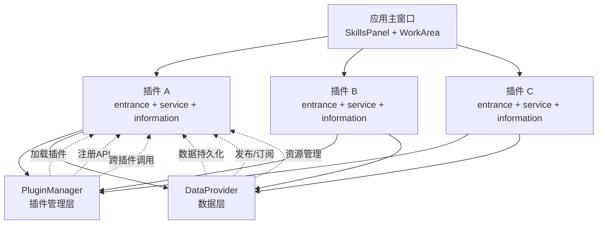

# InstructionX 技术文档

> InstructionX 插件式桌面应用程序完整技术文档

---

## 文档导航

本文档为 InstructionX 项目提供完整的技术参考，包含架构设计、模块详解和 API 参考。

---

## 文档结构

```
docs/
├── README.md                              # 文档索引与导航
├── tui-setup.md                           # 原生 Setup 安装、维护与验证
│
├── architecture/                          # 当前架构与可靠性文档
│   ├── overview.md                        # 系统架构概述（当前架构入口）
│   ├── module-dependencies.md             # 模块依赖与职责边界
│   ├── plugin-isolation.md                # 可选进程隔离与 watchdog
│   ├── foundation-slo.md                  # 可靠性目标
│   ├── foundation-performance.md          # 性能证据
│   ├── foundation-validation.md           # 故障、兼容与长稳验证
│   ├── foundation-verification-report.md  # 验证结果与边界
│   ├── foundation-deployment-guide.md     # 部署、灰度与回滚
│   ├── full-analysis.md                   # 历史档案，停止维护
│   └── instructionx-architecture.md       # 历史档案，停止维护
│
├── core/                                  # 核心模块专项文档
│   ├── interfaces/                        # 抽象接口层与 ILogger
│   ├── plugin-system/                     # 插件生命周期、开发、安装与配置
│   ├── data-provider/                     # DataProvider、API 与 SQLite 迁移
│   ├── background-task/                   # 任务系统、API 与 TaskStorage
│   ├── font-manager/                      # 字体子系统
│   ├── i18n/                              # 多语言子系统
│   ├── llm-provider/                      # LLM 架构、API 与配置
│   ├── mcp/                               # MCP Server / Client
│   └── observability/                     # 可观测性与框架事件
│
├── api/
│   └── full-reference.md                  # 核心 API 索引
│
├── ui/                                    # UI 组件与迁移文档
│   ├── main-window.md
│   ├── skills-panel.md
│   ├── skill-button.md
│   ├── work-area.md
│   ├── system-tray.md
│   ├── dialogs.md
│   └── uikit-migration-alpha-v104.md
│
├── utils/
│   ├── logging-tools.md
│   ├── uikit-theme.md
│   └── gc-main-thread.md                  # 主线程 GC 分代调度与边界
│
├── plugins/                               # 插件开发与集成指南
│   ├── index.md
│   ├── thirdparty-plugins.md
│   └── llm-integration-guide.md
│
├── security/
│   └── dependency-management.md           # Python 与 Rust 依赖安全流程
│
└── superpowers/plans/                     # 历史实施计划，非当前行为依据
```

> 另：仓库根目录的 [`插件开发流程.md`](../插件开发流程.md) 为**插件开发快速入门指南**（环境初始化 / 插件仓库配置 / AI 辅助提示词模板），面向插件开发者。

---

## 学习路径

### 入门路径（推荐）

1. **[系统架构概述](architecture/overview.md)** - 了解项目整体架构
2. **[模块依赖关系](architecture/module-dependencies.md)** - 理解模块间关系
3. **[插件系统概述](core/plugin-system/overview.md)** - 理解插件机制
4. **[插件开发指南](core/plugin-system/plugin-development.md)** - 开发自己的插件

### 进阶路径

5. **[接口层概述](core/interfaces/overview.md)** - 理解抽象接口设计
6. **[DataProvider 数据层](core/data-provider/overview.md)** - 理解数据层
7. **[DataProvider API 参考](core/data-provider/api-reference.md)** - 掌握数据 API
8. **[PluginManager](core/plugin-system/plugin-manager.md)** - 理解插件管理
9. **[IPlugin 接口](core/plugin-system/iplugin.md)** - 深入插件接口

### 高级路径

10. **[后台任务系统概述](core/background-task/overview.md)** - 后台任务系统
11. **[后台任务 API 参考](core/background-task/api-reference.md)** - 任务 API
12. **[LLM Provider 数据层](core/llm-provider/overview.md)** - LLM 提供者框架
13. **[LLM Provider API 参考](core/llm-provider/api-reference.md)** - LLM API
14. **[MCP 协议模块](core/mcp/overview.md)** - MCP 协议支持（Server + Client）
15. **[LLM 集成指南](plugins/llm-integration-guide.md)** - 在插件中使用 LLM 服务
16. **[多语言子系统概述](core/i18n/overview.md)** - i18n 取词、语言切换与插件语言包
17. **[可观测性与框架事件](core/observability/overview.md)** - 健康、指标与关联上下文
18. **[主窗口](ui/main-window.md)** - 界面组件详解
19. **[原生 Setup / TUI](tui-setup.md)** - 安装、维护与发布验证
20. **[可靠性部署与回滚](architecture/foundation-deployment-guide.md)** - 部署灰度与验收边界
21. **[API 完整参考](api/full-reference.md)** - 所有 API 索引

### 插件参考

22. **[插件文档](plugins/index.md)** - 所有插件总览
23. **[第三方插件](plugins/thirdparty-plugins.md)** - 第三方插件说明

---

## 核心概念

### 单例模式

项目核心组件均采用单例模式，确保全局唯一性：

- **PluginManager** - 插件管理器（插件的加载、注册、排序）
- **DataProvider** - 数据提供者（数据持久化、发布/订阅、插件间通信）
- **BackgroundTaskManager** - 后台任务管理器（同步/异步任务、定时任务、长期任务）
- **LLMProvider** - LLM 核心层（多厂商 LLM 底层管理，通过 get_llm_provider() 获取）
- **LLMPluginService** - LLM 插件服务层（对话管理、工具调用、多模态，插件开发者入口）
- **MCPManager** - MCP 协议协调器（Server 模式暴露插件工具，Client 模式消费外部 MCP Server 工具）
- **FontManager** - 字体管理器（字体安装/卸载、注册表持久化、系统字体回退，通过 get_font_manager() 获取）
- **LanguageManager** - 语言管理器（框架/插件文案取词、语言实时切换、每插件语言覆盖，通过 get_language_manager() 获取）

### 插件系统



### 命名空间

DataProvider 使用两种数据命名空间：

- **PRIVATE** - 仅插件内部使用
- **PUBLIC** - 可被其他插件访问和订阅

---

## 快速参考

### 核心类导入

```python
# 插件系统
from core import PluginManager, IPlugin, IPluginInfo

# 数据层
from core import DataProvider, DataNamespace

# 后台任务
from core import BackgroundTaskManager, TaskType, TaskStatus

# LLM 提供者
from core.llm import get_llm_provider

# LLM 插件服务层（推荐插件开发者使用）
from core.llm import get_llm_plugin_service, LLMPluginService
from core.llm import Conversation, ToolResult, UsageStats

# MCP 协议
from core.mcp import get_mcp_manager, MCPManager

# 多语言（i18n）
from core.i18n import get_language_manager, tr

# 抽象接口层（推荐通过接口而非直接依赖实现）
from core.interfaces import (
    IDataProvider, DataNamespace,
    ITaskManager, TaskType, TaskStatus,
    ILLMService, PluginServices, ILogger
)
```

### 获取单例实例

```python
# 插件管理器
plugin_manager = PluginManager()
# 或
plugin_manager = get_plugin_manager()

# 数据提供者
data_provider = DataProvider()

# 后台任务管理器
task_manager = BackgroundTaskManager()

# LLM 提供者
llm_provider = get_llm_provider()

# LLM 插件服务层（推荐）
llm_service = get_llm_plugin_service()

# MCP 管理器
mcp_manager = get_mcp_manager()
```

---

## 相关文档

- [插件开发指南](core/plugin-system/plugin-development.md)
- [DataProvider API 参考](core/data-provider/api-reference.md)
- [MCP 协议模块概述](core/mcp/overview.md)
- [日志工具](utils/logging-tools.md)
- [UIKit 主题系统](utils/uikit-theme.md)
- [完整 API 参考](api/full-reference.md)

---

## 版本

本文档对应 InstructionX 项目最新版本。
