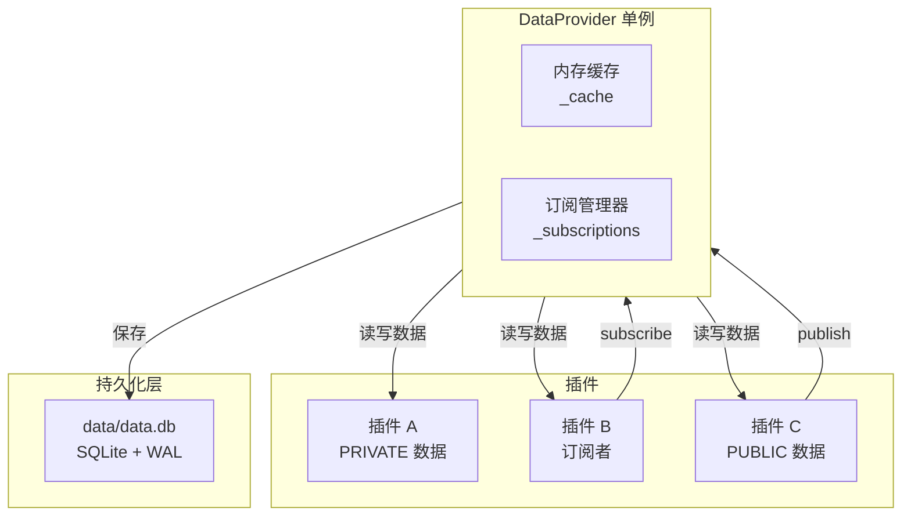
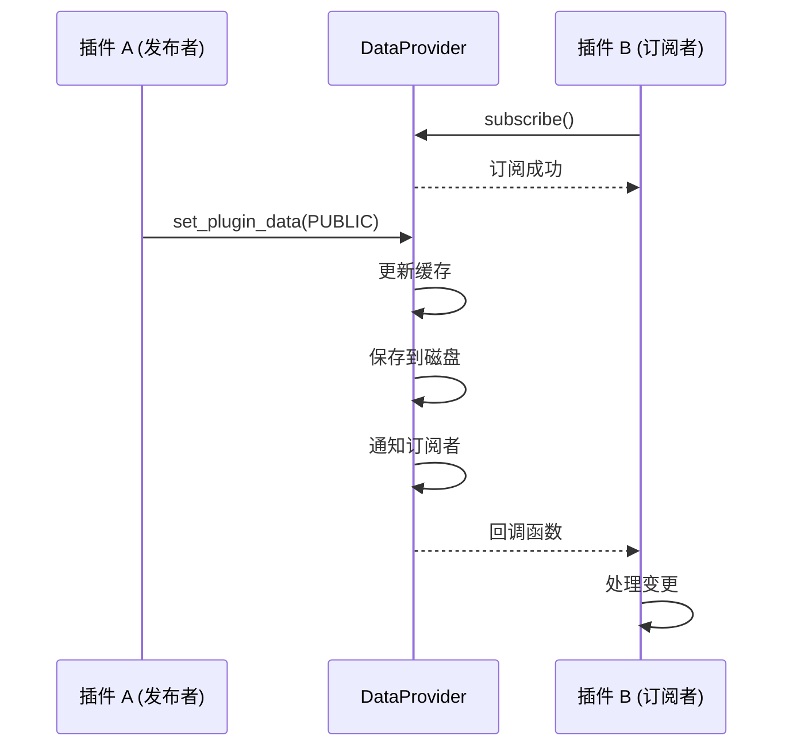
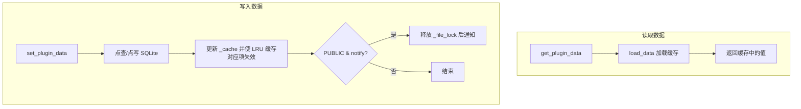

# DataProvider 数据层

> 数据提供者的架构设计和核心概念

---

## 1. 概述

`DataProvider` 是 InstructionX 项目的核心数据组件，负责插件数据的持久化、缓存管理、插件注册、发布/订阅通信和资源文件管理。

**文件位置**: `core/data/data_provider.py`

**模式**: 单例模式（全局唯一实例）

---

## 2. 核心特性

| 特性 | 说明 |
|------|------|
| **单例模式** | 全局唯一实例，确保数据一致性 |
| **线程安全** | 使用 `_file_lock`（RLock）保护数据库访问 + `_subscription_lock`（Lock）保护订阅表 |
| **原子写入** | SQLite WAL + 语句级/显式事务，保证数据一致性 |
| **内存缓存** | 全量字典缓存 + 按 key 的 LRU 反序列化缓存，减少 I/O 与重复解析 |
| **命名空间隔离** | 严格区分私有数据和公共数据 |
| **发布/订阅** | 支持插件间的实时数据通信 |
| **资源管理** | 统一的插件资源文件存储 |
| **插件实例管理** | 支持多实例注册、活跃实例切换、插件注销 |
| **重置机制** | `reset_all_data()` 支持清空所有数据（属于 `IDataProvider` 接口契约） |

---

## 3. 架构图



---

## 4. 数据命名空间

### 4.1 命名空间类型

```python
class DataNamespace(Enum):
    """数据命名空间枚举"""
    PRIVATE = "private"  # 仅插件内部使用
    PUBLIC = "public"    # 允许其他插件访问
```

### 4.2 PRIVATE（私有数据）

- **用途**: 插件内部配置、临时数据、状态信息
- **访问**: 仅插件自身可以读写
- **示例**:
  ```python
  # 保存私有配置
  provider.set_plugin_data(
      plugin_id,
      "internal_config",
      {"theme": "dark"},
      DataNamespace.PRIVATE
  )
  ```

### 4.3 PUBLIC（公共数据）

- **用途**: 需要与其他插件共享的数据、事件、状态变化
- **访问**: 所有插件可以读取
- **订阅**: 其他插件可以订阅数据变化
- **示例**:
  ```python
  # 保存公共数据
  provider.set_plugin_data(
      plugin_id,
      "current_status",
      "ready",
      DataNamespace.PUBLIC
  )
  ```

---

## 5. 发布/订阅模式

### 5.1 原理



### 5.2 使用场景

| 场景 | 推荐方式 |
|------|---------|
| 事件通知 | 发布/订阅 |
| 状态变化 | 发布/订阅 |
| 功能调用 | API 调用 |

### 5.3 示例代码

**订阅者（插件 B）**:

```python
class SubscriberService:
    def __init__(self, plugin_id, data_provider):
        self.plugin_id = plugin_id
        self.data_provider = data_provider

    def subscribe_to_publisher(self, publisher_id):
        """订阅发布者的数据变化"""
        self.data_provider.subscribe(
            subscriber_id=self.plugin_id,
            target_plugin_id=publisher_id,
            target_key="status",
            callback=self._on_status_change
        )

    def _on_status_change(self, plugin_id, key, old_value, new_value):
        print(f"状态从 {old_value} 变为 {new_value}")
```

**发布者（插件 A）**:

```python
class PublisherService:
    def __init__(self, plugin_id, data_provider):
        self.plugin_id = plugin_id
        self.data_provider = data_provider

    def update_status(self, new_status):
        """更新状态（会自动通知订阅者）"""
        self.data_provider.set_plugin_data(
            self.plugin_id,
            "status",
            new_status,
            DataNamespace.PUBLIC
        )
```

---

## 6. 资源管理

### 6.1 资源目录结构

```
data/
├── data.db                 # SQLite 主数据库
├── data.db-wal             # WAL 日志（正常运行时自动生成）
├── data.db-shm             # WAL 共享内存索引（正常运行时自动生成）
└── assets/
    └── plugins/
        ├── plugin_uuid_1/
        │   ├── thumbnail.png
        │   └── config.json
        └── plugin_uuid_2/
            └── ...
```

### 6.2 资源 API

> **异常说明**: 资源操作失败时抛出 `DataProviderError`（定义在 `core/data/data_provider.py`）。

```python
# 保存资源
relative_path = provider.save_asset(
    plugin_id="plugin-uuid",
    filename="thumbnail.png",
    content=b"图片二进制数据"
)

# 获取绝对路径
absolute_path = provider.get_asset_path(relative_path)

# 加载资源
content = provider.load_asset(relative_path)

# 获取插件资源目录
assets_dir = provider.get_plugin_assets_dir("plugin-uuid")
```

---

## 7. 核心流程

### 7.1 数据读写流程



### 7.2 SQLite 持久化机制

迁移后，`DataProvider` 默认使用 SQLite 作为持久化后端：

- 数据库文件：`data/data.db`
- WAL 模式：`PRAGMA journal_mode = WAL;`
- 外键约束：`PRAGMA foreign_keys = ON;`
- 同步级别：`PRAGMA synchronous = NORMAL;`

`set_plugin_data` 等单条写入使用 SQLite 语句级原子性（UPSERT）保证，不依赖显式事务。`save_data` / `reset_all_data` / `set_active_instance` 使用 `BEGIN IMMEDIATE` 显式事务，异常时自动回滚。

全量写回的等效逻辑位于 `SQLiteBackend.save_data()`（`core/data/sqlite_backend.py`）：在 `transaction()` 上下文（`BEGIN IMMEDIATE` ... `COMMIT` / `ROLLBACK`）中先清空子表（`plugin_data`、`active_instances`）再清空父表（`plugins`），随后重新插入 `plugins`、`plugin_data`、`active_instances` 三张表，提交后清空 LRU 缓存（`_value_cache.clear()`）。所有 SQL 语句统一取自 `sql_map.SQLMap`（`core/data/sql_map.py`），不在方法内散落字面 SQL。

#### 7.2.1 启动备份、损坏隔离与失败恢复

`SQLiteBackend.ensure_database()` 在打开可写连接前区分不存在、空库、完整、损坏、锁定和 I/O 故障。原库分类使用只读 `immutable=1` 连接执行 `PRAGMA integrity_check`，避免检查过程改写原 SHM；初始化结束后还会再次执行完整性检查。

- **启动备份**：合法非空既有库在首次写连接前生成同目录 `数据文件名.backup-<UTC时间戳>/`，复制主库及现存 WAL/SHM，记录逐文件 SHA-256 并验证副本完整性。备份创建或校验失败会停止启动，不继续修改原库。
- **损坏隔离**：损坏库生成同目录 `数据文件名.quarantine-<UTC时间戳>/`，主库/WAL/SHM 原文件保持不动，随后停止启动并提示人工恢复；隔离失败同样停止，不以空库替代用户数据。锁定、权限或 I/O 故障不会被误判为新库。
- **迁移失败恢复**：既有库发生 schema 迁移、最终完整性检查等初始化异常时，使用启动备份恢复原库版本和用户值。只有启动前三文件均不存在、且从未提交用户数据的新库，才允许在失败后清理。
- **分阶段恢复**：恢复前先校验恢复点，在本次新建的暂存目录中复制并校验新文件、备份当前主库和伴生状态，再以同文件系统暂存文件逐文件 `os.replace`；恢复点中不存在的伴生文件按状态删除。任一暂存复制、目标替换或删除异常都会使用旧文件副本回滚全部主库/WAL/SHM，恢复点本身保留。暂存目录碰撞或清理都只针对本次成功创建的目录，不删除既有恢复点或用户目录。

多文件替换**不是一次物理原子操作**。上述保证覆盖可捕获的复制、替换和删除异常，并在这些异常后回滚到一致旧状态；进程异常退出、断电等发生在两次替换之间时仍可能留下混合版本，需要利用保留的启动备份或隔离副本人工恢复。回滚本身失败时保留暂存旧文件并报告人工指引。

这些快照是启动前文件级恢复点，**不是跨进程在线备份协议**。备份期间不应有外部进程写库；本机制不协调外部写入者，也不替代独立备份方案。当前未提供启动备份保留数量或自动清理策略，长期运行会积累目录，需由运维另行管理存储空间，不能为释放空间而删除唯一恢复点。

### 7.3 JSON 应急回退

设置环境变量 `INSTRUCTIONX_DATAPROVIDER_BACKEND=json` 可强制 `DataProvider` 回退到旧 JSON 后端（临时文件 + 原子重命名），主要用于应急排查。

### 7.4 从 JSON 自动迁移

首次启动时，如果检测到旧的 `data/data.json` 且 `data/data.db` 尚未初始化，`SQLiteBackend` 会自动将 JSON 数据导入 `data/data.db`。迁移成功后，原 `data.json` 会被重命名为 `data.migrated-<timestamp>.bak`。只有主库/WAL/SHM 在启动前均不存在且事务尚未提交用户数据时，失败才允许清理本次不完整的新库；既有数据库或已提交用户数据的新库均保留，原始 JSON 在成功重命名前不会移除。

### 7.5 Schema 版本与链式升级

SQLite 后端的表结构由 `db_metadata.schema_version`（字符串正整数）追踪版本：

- **单一来源**：`core/data/schema_migrations.py` 的 `MIGRATIONS` 注册表（`Dict[int, MigrationFunc]`）+ `TARGET_SCHEMA_VERSION` 常量；新增表结构或变更时**必须**在此注册一个新版本号的迁移函数，不得就地修改既有迁移。
- **链式升级**：`SQLiteBackend.ensure_database()` 启动时读取当前版本，与 `TARGET_SCHEMA_VERSION` 比较；`current < target` 时按 `current+1, current+2, ...` 顺序逐个执行，每次迁移在独立 `BEGIN IMMEDIATE ... COMMIT / ROLLBACK` 事务中完成；中途失败抛 `SQLiteBackendError` 并回滚当前迁移，不会留下半成品 schema。
- **高版本库拒绝启动**：若 `current > target`，抛 `SQLiteBackendError` 提示「数据库由更高版本代码创建」，不会做兼容性猜测——数据层不试图跨版本兼容，向上迁移必须升级应用。
- **早期无版本数据库**：旧库无 `db_metadata` 表时按「基线表已存在」处理，直接补齐 `db_metadata`（写入 `schema_version=TARGET_SCHEMA_VERSION`、`migrated_from="legacy"`、`migrated_at=now`），**不调用链式升级**。
- **schema 验证**：`SQLiteBackend._validate_table_schema()` 在启动后期校验表结构是否与 `sql_map.SQLMap` 一致，不一致即抛错。

完整 schema 演进路线与迁移脚本编写约定见 [`docs/core/data-provider/sqlite-migration-plan.md`](sqlite-migration-plan.md)。

### 7.6 值序列化限制（对插件可见）

`SQLiteBackend._serialize()` 拒绝以下类型作为 `set_plugin_data()` / `publish()` 的 value（递归扫描，命中即抛 `SQLiteBackendError`，与 `json` 行为对齐）：

- `datetime` / `date` / `time`
- `NaN` / `Inf`（`float('nan')` / `float('inf')` / `float('-inf')`）
- `UUID`
- `bytes` / `bytearray`
- `set` / `frozenset` / `deque`
- 普通 `Enum` 实例（`IntEnum` / `IntFlag` 因与 int 等价不在拒绝之列）
- 任何 dataclass 实例
- tuple 作 `dict` key

序列化使用 `orjson`（含 `OPT_NON_STR_KEYS` / `OPT_PASSTHROUGH_DATETIME` / `OPT_PASSTHROUGH_DATACLASS`），键只接受 `str/int/float/bool/None`（其它类型 key 抛错）。

> **JSON 应急后端（`INSTRUCTIONX_DATAPROVIDER_BACKEND=json`）的限制更宽松**：`bytes` / `datetime` / `tuple` 等会被 `json` 静默降级（如 `bytes → []`），调用方不会感知失败——数据已损坏。生产路径务必使用 SQLite 后端，让序列化失败尽早暴露。

### 7.7 资源文件路径约束

`save_asset()` / `get_asset_path()` / `load_asset()` 共同执行**双向路径消毒**：

- 拒绝绝对路径（含盘符或以 `/` 开头）；
- 拒绝 `..` 路径穿越；
- 解析后必须仍位于数据目录或插件资产目录下（防止根相对路径/符号链接绕过）；
- 不合规路径抛 `DataProviderError`（由 `SQLiteBackendError` 包装）。

---

## 8. 数据结构

迁移后，数据持久化在 `data/data.db` 的以下表中。`DataProvider` 仍通过 `load_data()` / `save_data()` 暴露与旧 JSON 结构一致的字典视图。

### 8.1 SQLite 表结构

```sql
-- 插件实例主表
CREATE TABLE plugins (
    instance_id TEXT PRIMARY KEY,
    plugin_type TEXT NOT NULL,
    active      INTEGER NOT NULL DEFAULT 0 CHECK (active IN (0, 1))
);

-- 插件键值数据表
CREATE TABLE plugin_data (
    id          INTEGER PRIMARY KEY AUTOINCREMENT,
    instance_id TEXT NOT NULL,
    namespace   TEXT NOT NULL CHECK (namespace IN ('private', 'public')),
    key         TEXT NOT NULL,
    value_json  TEXT NOT NULL,
    updated_at  INTEGER NOT NULL DEFAULT (strftime('%s', 'now')),
    FOREIGN KEY (instance_id) REFERENCES plugins(instance_id) ON DELETE CASCADE,
    UNIQUE (instance_id, namespace, key)
);

-- 活跃实例映射表
CREATE TABLE active_instances (
    plugin_type TEXT PRIMARY KEY,
    instance_id TEXT NOT NULL,
    FOREIGN KEY (instance_id) REFERENCES plugins(instance_id) ON DELETE CASCADE
);

-- 数据库元数据表
CREATE TABLE db_metadata (
    key   TEXT PRIMARY KEY,
    value TEXT NOT NULL
);

-- 索引：加速 plugin_type 查询（活跃实例切换）
CREATE INDEX idx_plugins_type ON plugins(plugin_type);
```

---

## 9. 线程安全

### 9.1 锁的使用

```python
class DataProvider:
    def __init__(self):
        # 可重入锁 - 保护 SQLite 连接与缓存
        self._file_lock = threading.RLock()
        # 普通锁 - 订阅表操作不得与 _file_lock 同时持有
        self._subscription_lock = threading.Lock()
```

### 9.2 注意事项

- 避免在回调函数中持有 DataProvider 锁
- 长时间运行的操作应在回调外执行
- 注意潜在的死锁风险

---

## 10. 相关文档

- [DataProvider API 参考](api-reference.md)
- [插件开发指南](../plugin-system/plugin-development.md)
- [系统架构概述](../../architecture/overview.md)
